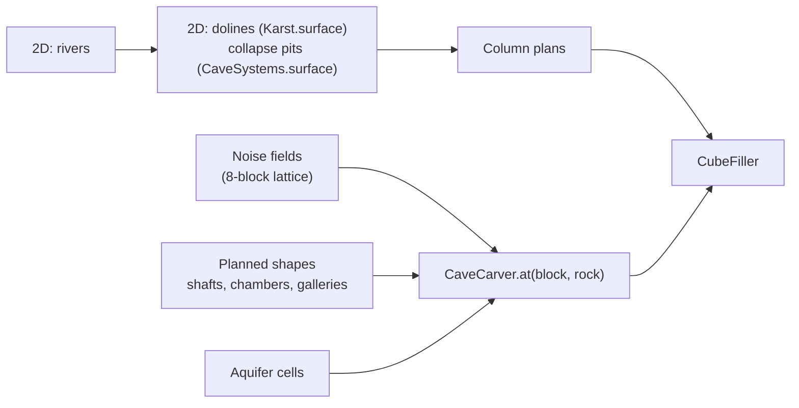

# Caves Overview

Back to [[Worldgen Overview]] · carved while filling cubes ([[Blocks and Chunks]]) · the karst and collapse pits also change the 2D terrain after [[Rivers Overview|the rivers]] · the shapes follow the rock of the [[Blocks and Chunks|3D Crust]].

Code: `worldgen/terrain/caves/` (`CaveCarver`, `CaveNoise`, `Karst`, `CaveSystems`, `CaveFeatures`), `CubeFiller`, `WorldGen.evaluate` (2D part).

Cubic Chunks lets the world go down to Y −2048. The crust was solid rock all the way: this section hollows it out with a **hybrid** system: noise caves everywhere (most of the void), plus planned pieces that make sense of the landscape.

| Page | Covers |
|---|---|
| [[Noise Caves]] | caverns, huge deep caverns, tunnels, fissures, lava tubes; the shape by rock; the cost |
| [[Aquifers and Lava]] | flooded and lava cells, barriers, the lava sea at the bottom, the safety layer under water |
| [[Karst]] | dolines, shafts, sea caves and cave mouths in cliffs |
| [[Cave Systems]] | giant chambers, galleries, collapse pits (cenotes), the great entrance of every system |
| [[Cave Entrances]] | hillside cave mouths, entrance zones, great entrances: where caves open to the surface |

## In reality

Large caves form almost only in soluble rock (limestone, dolostone, gypsum, salt: **karst**), where water dissolves passages along fractures, mostly at the level of the water table. Other caves: **lava tubes** in basalt, **sea caves** cut by waves, fissure and tectonic caves in hard rock. Here caves exist in every rock (a gameplay choice), but the rock still decides how big they are and what shape they take.

## Design decisions (2026-11-07)

| Decision | Choice |
|---|---|
| depth and size | down to the bottom of the world; giant halls (up to ~360 blocks); modern-Minecraft-like void (≈ 7.5–13 %, revised 2026-11-07 from 4–6 %: caves were too narrow and vertical) |
| rock and shape | the rock changes the shape, not only the size |
| water | aquifers, a safety layer under rivers, lakes and the sea, lava down deep |
| entrances | frequent hillside mouths, and a great entrance for every planned system; collapse pits change the terrain |
| decoration | none yet (no speleothem blocks in 1.7.10) |
| cost | about the cost of the surface: +0.14 ms per crust cube |
| GregTech ores | not handled yet |

## Pipeline

## Parameters (`GenParams`)

| Parameter | Default | Effect |
|---|---|---|
| `caves` | 1 | amount of noise caves (lower thresholds, wider tunnels above 1; 0 off) |
| `caveEntrances` | 1 | share of the land where caves may reach the surface |
| `aquifers` | 1 | share of flooded cells |
| `dolines` | 1 | doline density (and their shafts) |
| `plannedCaves` | 1 | chambers per region (0 off) |

All are 0 in `ParityTest`.

## Tests and debugging

- `CaveTest.cavesAreSane`: void by depth band and by rock style, water and lava shares, nothing carved in the safety layer under water, no water standing next to air.
- `CaveTest.caveCost`: crust cube with and without caves.
- `CaveTest.karstDolinesAndShafts`, `CaveTest.plannedSystems`.
- `VIRIDIUM_CAVES=x0,x1,z,yTop,yBottom` (`CaveTest.section`): ASCII vertical section (`#` rock, space air, `~` water, `^` lava, `.` above the ground).
