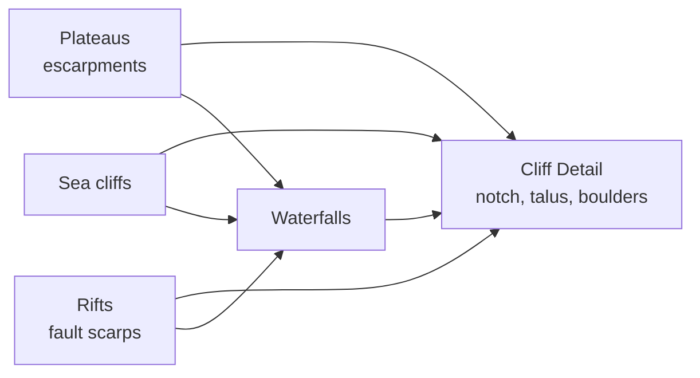

# Landforms Overview

Back to [[Worldgen Overview]] · built into [[Worldgen Stages]] (continents, relief, erosion) and [[Rivers Overview]] (waterfalls) · drawn by [[Blocks and Chunks]] (notches, talus, boulders, curtains).

This section documents the landforms added on top of the base relief: **plateaus and mesas, sea cliffs, continental rifts and waterfalls**, plus the block-level detail every cliff gets (notch, talus, fallen boulders). Each page starts from how the landform forms in reality and maps that onto the model.

| Page | Covers | Where in the code |
|---|---|---|
| [[Plateaus and Mesas]] | uplifted tablelands, basalt traps, arid terracing | `ReliefStage.plateau`, `ErosionStage.mesas`, `GeologyStage` |
| [[Sea Cliffs]] | rocky coasts standing above the sea, coves | `ReliefStage.coastalCliff` |
| [[Continental Rifts]] | graben, shoulders, rift lakes, volcanoes, narrow seas | `ContinentStage.rift`, `ReliefStage.rift` |
| [[Cliff Detail]] | notch at the foot of a cliff, talus, fallen boulders, falling water at river lips | `column/CliffDetail`, `CubeFiller`, `FloraPlanner` |
| [[Waterfalls]] | rivers that keep their level to a cliff and fall over it | `RiverNetBuilder.findFalls`, `RiverStage` |

## How they fit together

They all produce, or use, **steps** in the terrain:

- Plateaus, sea cliffs and rift faults set `GenPoint.scarp` near their edge. [[Worldgen Stages|Erosion]] leaves the scarp alone: its gradient comes from a coarse lattice and would dig a moat along the foot or leave a rim along the top. The river network only looks for waterfalls where a scarp is near.
- [[Cliff Detail]] does not know which landform made a wall: it finds walls from the planned heights of a column and its neighbours, so any cliff (also a steep gorge or a collision range) gets it.

## Parameters

All in `GenParams`, Java-only; `0` turns a landform off. `ParityTest` turns them all off (the JS prototype has none).

| Parameter | Default | Effect |
|---|---|---|
| `plateaus` | 1 | frequency of plateaus (shifts the threshold of their mask) |
| `plateauHeight` | 1 | height multiplier (60–150 blocks above the plains) |
| `mesas` | 1 | arid terracing strength |
| `cliffs` | 1 | frequency and height of sea cliffs |
| `cliffDetail` | 1 | notch, talus and boulders (size and amount) |
| `rifts` | 1 | share of continents with a rift (0.35 per unit) |
| `riftDepth` | 1 | depth of the graben and height of the shoulders |
| `waterfalls` | 1 | waterfalls on (higher also allows lower falls) |

## Debugging

- Map layer **Landforms** (`MapLayer.LANDFORMS`): grey relief with plateaus (ochre; basalt traps purple), mesas (red), sea cliffs (white), rifts (red young, brown failed, teal mature), rift volcanoes (dark red).
- `VIRIDIUM_PROFILE=x0,z0,x1,z1,step` (`DebugPointTest.profile`): heights and landform fields along a line.
- `VIRIDIUM_CLIFF=x0,x1,z`: ASCII section with notches (`o`, `w` flooded), talus (`+`), water (`~`) and curtains (`|`).
- `VIRIDIUM_FALLMAP=x0,z0,size,split`: plan view around a waterfall.
- Tests: `CliffDetailTest`, `WaterfallTest`; `RiverWaterTest` skips waterfall zones (`F_FALL`).
