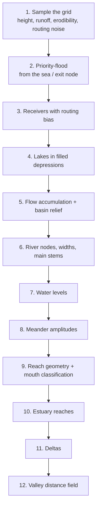

# River Network Build

Part of [[Rivers Overview]] · depends on: [[Drainage Basins]], [[Worldgen Stages|Tectonic Plates]], [[Worldgen Stages|Continents]], [[Worldgen Stages|Relief]],
[[Worldgen Stages|Surface Geology]], [[Worldgen Stages|Base Climate]] · continues in: River Water Levels, River Geometry and Meanders,
Lakes and Salt Flats, River Mouths, Deltas and Estuaries, Valleys, Gorges and Glacial Troughs · result
consumed by: River Stage Evaluation.

Code: `stages/RiverNetBuilder.java` (`build`), `stages/RiverNet.java`.

`RiverNetBuilder.build(cell)` produces the `RiverNet` of one basin cell. It is the heaviest computation of the
generator (tens of thousands of terrain samples), which is why networks are cached and prefetched
(River Stage Evaluation). The build runs these steps in order:



Steps 4, 7, 8-9, 10-11 and 12 have their own pages; this page covers the hydrology core (1-3, 5-6).

## The grid

- Node spacing `g = riverGrid` (32 blocks).
- The grid covers a square of half-size `H = 1.35·B + MARGIN` around the cell's feature point, with `B = basinSize`
  (3000) and `MARGIN = 960`: ≈ 10 000 blocks wide, **≈ 315 × 315 ≈ 99 000 nodes**.
- The origin is snapped to the global grid (`gx0 = floor((fx − H)/g)`), so **nodes are global**: two basins that both
  contain a node agree on its position. This is what makes exit nodes shared.
- Only nodes **owned** by the cell (`cellAt == cell`) are part of its hydrology. The rest of the grid (the margin over
  the neighbours) only receives the valley distance field, so valleys fade out smoothly across divides.
- Node centres are at `(i + 0.5)·g`. For the river **geometry**, each node is additionally jittered by up to ±0.35·g
  (`jx`, `jy`, seed `rivJ`), so rivers do not follow grid lines.

The flow threshold scales with the grid: `thr = riverThreshold·45·(32/g)²` runoff units.

## Sampling the grid

Rows are sampled in parallel (unless the calling thread is a background thread, see
River Stage Evaluation). For every owned node:

| Value | How |
|---|---|
| `hgt` | `baseHeight(detail = false)` from [[Worldgen Stages|Relief]]; `−1` (sea) if `L < −0.2` or the height is below 0. Using the relief rather than `L` alone matters: a pocket of slightly negative continentality can still be land, and a river ending in it would stop dead inland |
| `rkey` | routing noise: `riverRouteNoise·fbm(x/450, z/450)` (±8 blocks) |
| `cer` | rock erodibility from [[Worldgen Stages|Surface Geology]], ×255 |
| `run` | runoff: `Pb·(0.4 + 0.6·e^(−L/0.4))/1000` (base precipitation, wetter near the coast) **plus the inflow** from upstream basins at entry nodes |

Note that the network is built on the **smooth base relief** (`h0`, no erosion, no fine octaves): it is much cheaper,
and the routing only needs the large-scale shape. The water levels are later fitted to the real eroded terrain
(River Water Levels).

### Inflow from upstream basins

For every child cell (a basin that drains into this one, `graph.children(cell)`), its exit node is marked as an
**entry** node of this grid, and receives `inflow = childNet.exitFlow`: the flow that really leaves the upstream
network, which requires **building the upstream network first** (`gen.rivers.net(child)`). Entry nodes count as owned
even though they lie just across the divide.

If this cell drains into a neighbour, its own exit node is located on the grid (`exitIdx`) and also marked as owned.

## Priority-flood

A classic priority-flood (Barnes et al.) fills every closed depression and gives each node a receiver:

1. Seeds: every owned **sea** node, plus the **exit node** if the basin drains into a neighbour. Their filled height is
   their own height.
2. If there are no seeds at all (no sea, no exit: an endorheic basin), the lowest owned node is the only seed.
3. Pop the lowest node from a binary min-heap. For each unvisited owned 8-neighbour:
   `filled[nb] = max(hgt[nb], filled[cur] + ε)` with ε = 0.01 (orthogonal) or 0.014 (diagonal), `recv[nb] = cur`,
   push.

The ε guarantees a strictly downhill path on the filled surface, even across flats and filled lakes. The pop order
(`order[]`) is a topological order: every node comes after its receiver. It is reused everywhere: iterating it
backwards goes **upstream → downstream**.

The heap is a hand-written binary heap identical to the prototype's (tie order matters for parity).

## Receivers with routing bias

On smooth slopes and flats, steepest descent makes water run in parallel lines, one tiny river per grid node, which
never converge. So receivers are re-picked:

- for each land node, among the owned 8-neighbours whose `filled` is **strictly lower** (so the flood order stays a
  valid upstream → downstream order),
- pick the steepest `(filled + rkey)[node] − (filled + rkey)[nb]` per unit distance (`rkey` = 0 for sea nodes).

The ±8-block noise `rkey` carves gentle virtual valleys that make the flow converge into few rivers. `riverRouteNoise
= 0` disables it.

**No crossing links.** Two diagonal links through the same square of the grid (`a → d` and `b → c`) cross: two rivers
would run through each other. The higher of the two source nodes drains into the other instead (still strictly
downhill on `filled`).

### River capture

After the flow is accumulated, a river node next to (8-neighbour) a **lower** node of another river drains into it
instead, unless the two rivers join within three nodes anyway (`captureNeighbours`, upstream first; the flow is then
accumulated again, up to 4 rounds). Two rivers in neighbouring nodes are at most 32 blocks apart and, over the flats
the flood filled, used to run side by side for hundreds of blocks, each at its own level and with its own meanders:
channels overlapping and crossing, the higher one a wall of water over the other. Now they join where they meet.

## Flow accumulation

```
acc = run
for node in order, reversed (upstream first):   acc[recv] += acc[node]
                                                 relief[recv] = max(relief[recv], relief[node])
```

`relief` is the maximum height upstream of a node: the relief of the river's catchment, used to estimate the sediment
load at the mouth (River Mouths, Deltas and Estuaries).

## River nodes

A node is a **river node** if it is owned, on land, has a receiver, and `acc ≥ thr·riverStart` (1.6 threshold units).

Half-width as a function of flow in threshold units `f = acc / thr`:

```
halfWidth(f) = min(riverMaxHalfWidth, 1.2 + 2.2·√f + riverWidthGrowth·f)        riverMaxHalfWidth = 48, growth = 0.16
```

The square root dominates for small rivers; the linear term makes large rivers grow much wider (flow 100 → ~40 blocks
half-width).

| Flow (threshold units) | Half-width (blocks) |
|---|---|
| 1.6 (river start) | ≈ 4.2 |
| 5 | ≈ 7.0 |
| 20 | ≈ 14.2 |
| 100 | ≈ 39.2 |
| ≥ ~134 | 48 (cap) |

`mainUp[r]` is, for every node, its upstream river node with the largest flow: the **main stem**. Everything else
joining `r` is a tributary.

## What a RiverNet contains

| Field | Meaning |
|---|---|
| `x0, y0, g, nx, ny` | the grid |
| `slot[node]` | reach index of each river node, or −1 |
| `pts`, `bb` | reach polylines (9 points each) and their bounding boxes |
| `w0, w1`, `z0, z1` | half-width and water level at the upstream / downstream end of each reach |
| `acc`, `head` | flow (threshold units), headwater flag |
| `am0, am1` | distance to the mouth along the main stem at both ends |
| `reach` | how far a meandering curve strays from its node (search radius of queries) |
| `mouths`, `nMouth` | 14 floats per mouth (River Mouths, Deltas and Estuaries) |
| `estSeg` | reaches belonging to estuaries |
| `dv, dch, dmc, dbox` | delta distributaries: vertices, channels, per-mouth channel ranges and boxes |
| `skip` | reaches replaced by a delta |
| `vd, vz, vw, va, vr` | valley field per node: distance to the nearest river, its level ×16, half-width ×4, meander amplitude ×4, surrounding relief /2 |
| `cer` | erodibility ×255 per node |
| `lakes` | lake level per node (negative = salt flat) |
| `exitLevel`, `exitFlow` | water level and flow at the exit node: what the downstream basin receives |

`bytes` is an approximate retained size, for diagnostics.
