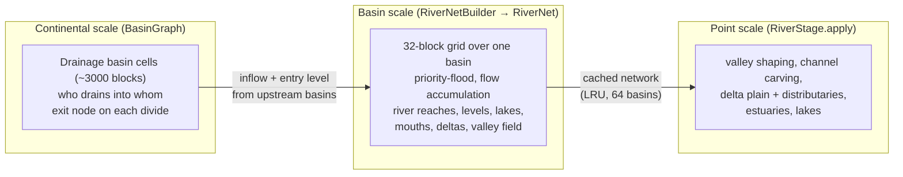

# Rivers Overview

Back to [[Worldgen Overview]] · stage 10 of the pipeline · depends on: [[Worldgen Stages|Base Climate]] (runoff), [[Worldgen Stages|Tectonic Plates]],
[[Worldgen Stages|Continents]], [[Worldgen Stages|Relief]], [[Worldgen Stages|Surface Geology]] (erodibility), [[Worldgen Stages|Final Climate]] (glaciation), [[Worldgen Stages|Erosion]] (final
terrain) · used by: [[Worldgen Stages|Cryosphere]], [[Worldgen Stages|Biome Stage]], [[Blocks and Chunks|Column Plans]] (water surface).

Code: `stages/BasinGraph.java`, `RiverNet.java`, `RiverNetBuilder.java`, `RiverStage.java`.

This page is the hub of the rivers section. This stage generates **rivers, lakes and salt flats, broad valleys, gorges, glacial troughs and fjords, deltas and estuaries**. It is by far the largest and most delicate part of the generator.

## Why rivers are hard

Every other stage is local: the value at (x, z) only depends on noise around (x, z). A river is not: whether there is a river here, how wide it is and at what level its water stands depend on **everything upstream**, possibly thousands of blocks away, and on where it ends, possibly thousands of blocks downstream. At the same time the world is infinite, generated in any order, on several threads, and must be identical every time.

The solution is to split the problem in three scales, each of which is a pure function of the seed:

1. **[[Drainage Basins]]**: continents are divided into warped Voronoi cells of ~3000 blocks. Each land cell drains either to the sea or into one neighbouring cell, through a fixed node on their shared divide. The cells form trees whose roots are on the coast.
2. **[[River Network Build]]**: for one basin cell, a 32-block grid is sampled, depressions are filled, every node gets a downstream receiver, flow is accumulated, and nodes with enough flow become river nodes. Then come the [[River Water Levels]], [[River Geometry and Meanders]], [[Lakes and Salt Flats]], [[River Mouths, Deltas and Estuaries|mouths]] and the valley distance field. The result, a `RiverNet`, is immutable
   and cached.
3. **[[River Stage Evaluation]]**: at a point, the networks of the basins near it are queried and the terrain is shaped: [[Valleys, Gorges and Glacial Troughs|broad valleys]] first, then river channels, then deltas, estuaries and
   lakes.

A basin's network needs the **flow and water level leaving each upstream basin**, so building a network first builds the networks of every basin that drains into it (recursively). There are no cycles: a cell only drains into a neighbour closer to the sea.

## Life of a river

1. Rain falls on every land node of the basin grid: runoff = base precipitation × an inland factor
   ([[River Network Build#Sampling the grid|sampling]]).
2. Water follows the receivers downhill on the depression-filled surface; flow accumulates.
3. Where accumulated flow reaches `riverStart × threshold`, a river begins (a headwater reach, which starts without a valley and fades in).
4. Its width grows with flow (`halfWidth`); its water surface follows the floor of the eroded valley around it, but never climbs downstream ([[River Water Levels]]).
5. It meanders where the slope is gentle and the river is wide enough ([[River Geometry and Meanders]]).
6. It joins larger rivers at confluences, descending to their level ([[River Water Levels#4. Tributaries]]).
7. If it crosses into another basin, it does so through the exit node of the divide, carrying all its flow and its water level ([[Drainage Basins#Exit nodes]]).
8. It ends at the sea: in a **delta** (big, sediment-laden rivers on low coasts), an **estuary** (tidal, smaller sediment load), or a **fjord** (glaciated valleys), see [[River Mouths, Deltas and Estuaries]]. Or it ends in a lake or an endorheic basin ([[Lakes and Salt Flats]]).

## Glossary

| Term | Meaning |
|---|---|
| **basin cell** | a drainage basin of [[Drainage Basins]] (`BasinGraph.Cell`), ~3000 blocks |
| **node** | a point of the 32-block river grid. Nodes are aligned to a global grid, so neighbouring basins share them. Their river position is jittered by ±0.35 grid cells (`jx`, `jy`) |
| **receiver** | the node a node drains into (`recv`) |
| **flow / acc** | accumulated runoff. Usually expressed in **threshold units** (`acc / thr`); a river starts at `riverStart` = 1.6 |
| **river node** | node with enough flow, a receiver, on land, inside the basin |
| **reach** | the piece of river belonging to one river node, from halfway to its upstream node to halfway to its receiver; stored as a polyline of 9 points (`RiverNet.SEG = 8` segments) |
| **main stem / mainUp** | for each node, the upstream river node with the largest flow. A tributary is any other upstream river node |
| **headwater** | a river node with no upstream river node (and not an entry) |
| **entry node** | a node where a river from an upstream basin enters (the upstream basin's exit node) |
| **exit node** | the node on the divide through which this basin's water leaves into its receiving basin |
| **mouth** | a river node whose receiver is sea |
| **apex** | point where a delta starts; distributaries fan out from there |
| **water level / wl** | absolute height (relative to sea level) of the water surface at a node |
| **valley field** | per-node distance to the nearest river, plus that river's level, width, meander amplitude and surrounding relief |

## Invariants the code works hard to keep

- **Water never climbs** going downstream, inside a basin and across basin divides.
- **Water never stands above dry ground** next to the channel (no "walls" of water), and is never perched above its valley floor. Checked by `RiverWaterTest`.
- **Continuity across basin divides**: valleys, channels and deltas of neighbouring basins all shape every point they reach, in phases, so nothing is cut at a divide.
- **Determinism**: every network depends only on its basin cell and the seed; caches never change the result.

Parameters and debugging tools are in [[River Parameters and Debugging]].
