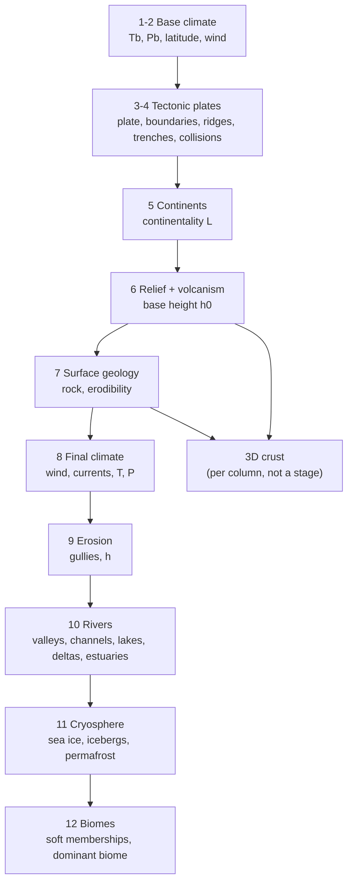

# Worldgen Overview

This section documents how the Viridium 2.0 terrain generator actually works. It is the implementation counterpart of the design notes in [[Terrain]].

## The big idea

Terrain is a **pure function of (x, z) and the seed**. There is no global simulation and no generation order: any column of the world can be computed on its own, on any thread, at any time, and always gives the same result. Every cache in the system is a deterministic cache: dropping it never changes the world.

The work is split in three layers:

1. **The 2D pipeline**: a chain of stages evaluated at one (x, z) point. Each stage reads what the previous ones wrote into a shared `GenPoint` and adds its own fields (temperature, plate, height, rock, river, biome...).
2. **Column planning**: the pipeline is run once per block column of a 16×16 chunk and turned into absolute Y values (surface, water, ice) plus a 3D crust profile.
3. **Cube filling**: each 16³ Cubic Chunks cube is filled from its column plan only, with no access to the world or to neighbouring cubes.

## How the documentation is organised

The pages are grouped into six sections. Each section has a hub page that lists its pages, and each page links to the pages of its own section that it draws on. When a page relies on something from another section, the link goes to that section's hub instead, so the sections stay readable as separate clusters in the graph view.

| Section | Hub | Covers |
|---|---|---|
| Foundations | [[Worldgen Foundations]] | how the pipeline is wired (`WorldGen`, `GenPoint`, stages, parameters, seeds) and the noise and math helpers every stage uses |
| 2D pipeline stages | [[Worldgen Stages]] | every stage from base climate to biomes, except rivers |
| Rivers | [[Rivers Overview]] | stage 10: drainage basins, per-basin networks, water levels, meanders, lakes, deltas, estuaries, valleys |
| Landforms | [[Landforms Overview]] | plateaus and mesas, sea cliffs, continental rifts, waterfalls, and the notch, talus and boulders at the foot of cliffs |
| Caves | [[Caves Overview]] | noise caves shaped by the rock, aquifers and lava, karst dolines and shafts, giant chambers, galleries and collapse pits |

Performance: costs per stage and the audit of 2026-11-07 are in [[Performance Audit]].
| Blocks and chunks | [[Blocks and Chunks]] | from pipeline output to blocks: 3D crust, column plans, cube filling, flora, Cubic Chunks wiring |

The stages run in this order (each one is described on its own page, listed in [[Worldgen Stages]]):

## Rivers

Rivers are the most complex part of the generator, and the only one that is **not** purely local: a river needs to know the whole drainage basin upstream of it. They are solved with pre-built, cached networks per drainage basin, still deterministic and order-independent. Start at [[Rivers Overview]].

## Units and conventions

- Distances are in blocks. Heights in the pipeline are **blocks relative to sea level** (0 = sea level); sea level is absolute Y 63 (`TerrainLayout.SEA_LEVEL`). The world is generated between Y −2048 and Y 1024.
- The pipeline keeps the prototype's axis names: its `y` is Minecraft's `z`.
- `ss(a, b, x)` is a smoothstep from a to b (falling if a > b). It is used everywhere as a soft threshold; see the noise and math page in [[Worldgen Foundations]].
- Vertically, the crust is scaled at roughly 1 block ≈ 25 m, so a normal continental crust is ≈ 1300 blocks thick.

## Debugging

- In-game map: every stage has at least one map layer (`map/MapLayer.java`: plates, boundaries, continentality, geology, erodibility, temperature, precipitation, wind, currents, rain shadow, erosion, rivers, valleys, cryosphere, biomes, composite...).
- `/viridium bench [radius] [cubesDown] [cubesUp]` and `/viridium stats [reset]`: timings of planning, river network builds and cube filling.
- Tests: the general ones are described with the pipeline in [[Worldgen Foundations]], the river ones in the rivers section.
